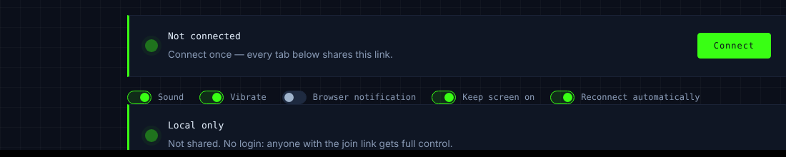
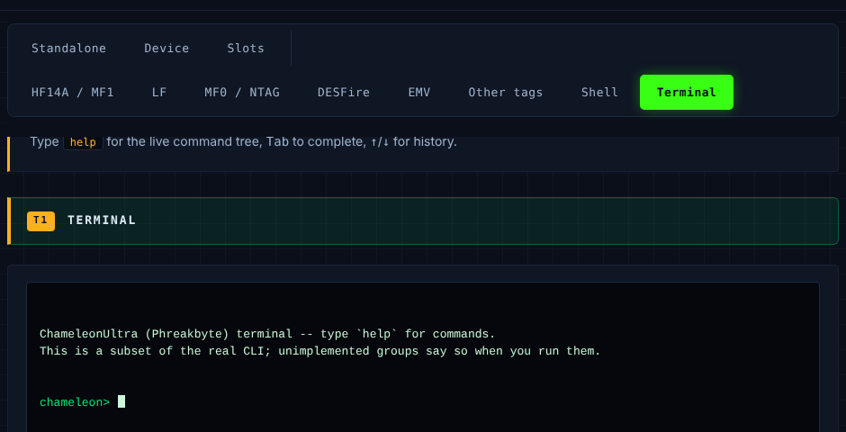
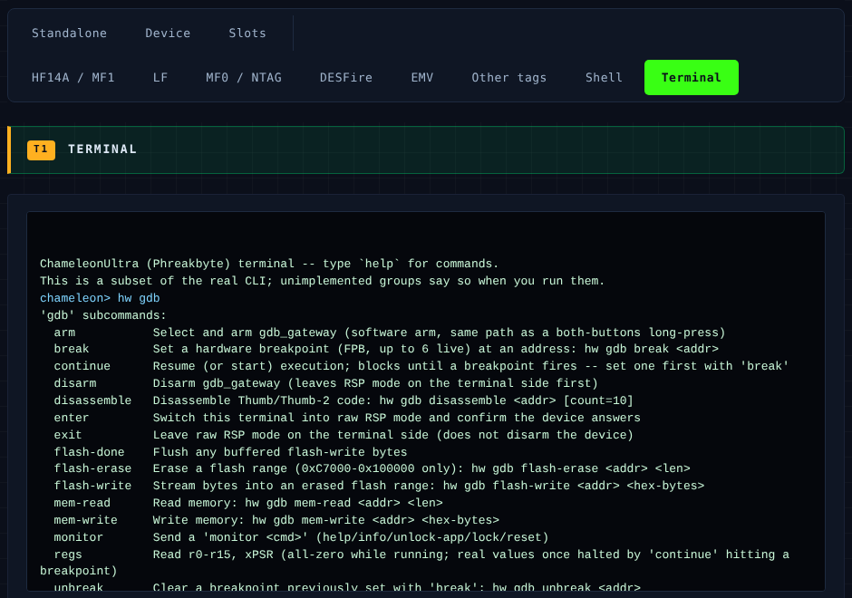
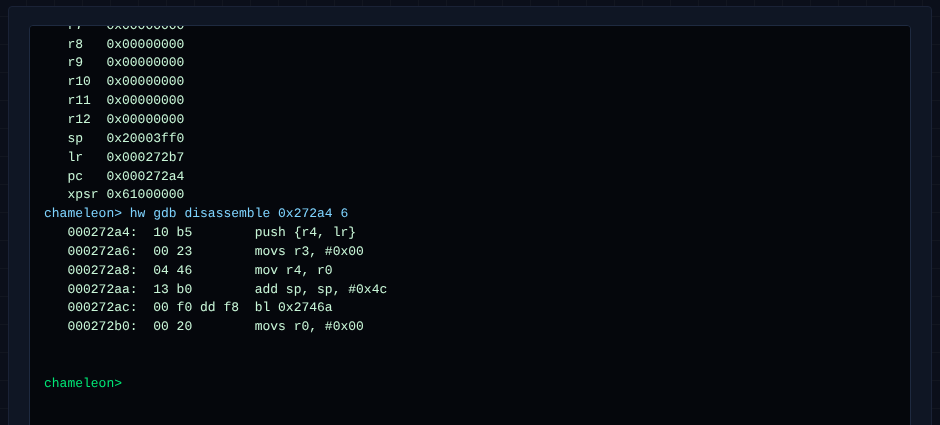

# Phreakbyte web console — instructions

Live at <https://sec1.dk/phreakbyte.html>. This is a single-page Web
Bluetooth console for the Phreakbyte fork of ChameleonUltra
(`nieldk/chameleonultra`) — standalone modes, device/slot management,
HF14A/MF1, LF, MF0/NTAG, and a raw terminal with the GDB memory/flash/
breakpoint gateway.


Requires a browser with Web Bluetooth (Chrome/Edge on desktop or Android;
not Safari/Firefox). The page only talks BLE — no server round-trip, no
install.

## 1. Connect

Click **Connect**, pick your ChameleonUltra from the browser's device
picker, and accept pairing if prompted. Every tab below shares this one
connection — connect once, then switch tabs freely.



- **Reconnect automatically** — reattaches on the same device if the link
  drops.
- **Keep screen on** — useful for long key-recovery attacks or sniffing
  sessions.
- The **Local only** box below it is for sharing your live session with a
  second browser/person over a relay; ignore it unless you've set up
  `relayUrl`.

## 2. Terminal tab

The **Terminal** tab (far right of the second tab row) is a CLI subset —
about 90 of the real ~195 `hw`/`hf`/`lf`/`slot`/`standalone`/`data`/`emv`
commands, typed the same way as the Python CLI. Unimplemented groups say so
when you run them rather than silently doing nothing.



- `help` — full live command tree for whatever's implemented.
- `Tab` — complete the current word.
- `↑` / `↓` — command history.
- Commands are space-separated, nested groups first: `hw gdb regs`, `hf 14a
  scan`, `slot list`, etc.

## 3. `hw gdb` — the GDB RSP gateway

This talks to the firmware's `gdb_gateway` standalone mode over the GDB
Remote Serial Protocol, straight from the browser — no SWD probe, no
`arm-none-eabi-gdb` required. It gives you memory/flash read-write and real
hardware breakpoints (Cortex-M4 FPB, up to 6) with register capture on
halt, plus a Thumb/Thumb-2 disassembler.

```
hw gdb
```



### Typical session

1. **Arm the gateway** (one-time, needs host opt-in since it can flash the
   device): `hw gdb arm`, or trigger it the normal standalone way (both-
   buttons long-press).
2. **Enter RSP mode** on the terminal side: `hw gdb enter`. This switches
   the active link (USB-CDC or BLE, whichever is up) from the framed CLI
   protocol to raw `$...#` packets and confirms the device answers.
3. **Set a breakpoint** at a real code address from your own build —
   resolve it with `arm-none-eabi-nm` against `firmware/objects/application.out`
   (built from `firmware/application/`, run `make` first if it doesn't
   exist yet):
   ```
   arm-none-eabi-nm firmware/objects/application.out | grep <function>
   ```
   Pick a function with **external linkage**, defined outside
   `utils/gdb_rsp.c`'s own call graph — otherwise the breakpoint can trip on
   the very RSP packets you're using to drive the session and hang. A
   `static` function that's only called from one place is also risky: the
   compiler often inlines it away entirely, leaving no symbol to break on.
   `data_frame_process` (`utils/dataframe.c`) is a safe, frequently-hit pick.
4. `hw gdb break 0x<addr>`, then `hw gdb continue` — blocks until the FPB
   fires.
5. Once halted: `hw gdb regs` (captured r0-r15 + xPSR, not zeroed) and
   `hw gdb disassemble <addr> [count]` to see real code around `pc`.
6. `hw gdb continue` again to resume, `hw gdb unbreak <addr>` to clear it,
   `hw gdb exit` to leave RSP mode (device stays armed), `hw gdb disarm` to
   fully exit the gateway.

The screenshot below is a synthetic/simulated session (no physical device
attached) used to show the real output formatting — register values and
disassembly are made-up but the commands and code paths are genuine:



### Other `hw gdb` commands

- `mem-read <addr> <len>` / `mem-write <addr> <hex-bytes>` — plain memory
  access, no breakpoint needed.
- `flash-erase <addr> <len>` / `flash-write <addr> <hex-bytes>` /
  `flash-done` — flash programming, restricted to `0xC7000`-`0x100000`
  unless you run `hw gdb monitor unlock-app` first.
- `monitor <cmd>` — `help`/`info`/`unlock-app`/`lock`/`reset`.

### Gotchas

- **`continue` blocks the terminal's RSP channel until it resolves** (hit,
  error, or a 15-minute timeout) — every other `hw gdb` command queues
  silently behind it with no visible output until it does. If you fire
  `continue` against a breakpoint that will never trip, you'll see nothing
  from any later `hw gdb` command either; reload the page to clear the
  stuck state rather than waiting out the timeout.
- `hw gdb exit` only leaves RSP mode on the terminal side — it does **not**
  release a stuck `continue`, since that's a separate client-side lock.
- No single-step: the firmware has no software-step path that survives a
  USB/SoftDevice IRQ mid-step without dropping the link, so breakpoints +
  `continue` are the whole execution-control story.

## Troubleshooting

- **Nothing happens / "Not connected"** — the GATT link dropped; hit
  **Connect** again.
- **`hw gdb` commands say "not in RSP mode"** — run `hw gdb enter` first.
- **A command just hangs with no output** — see the `continue`-blocks-the-
  channel gotcha above.
